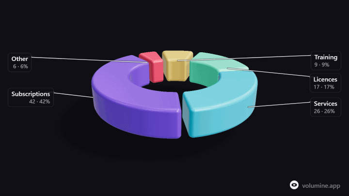
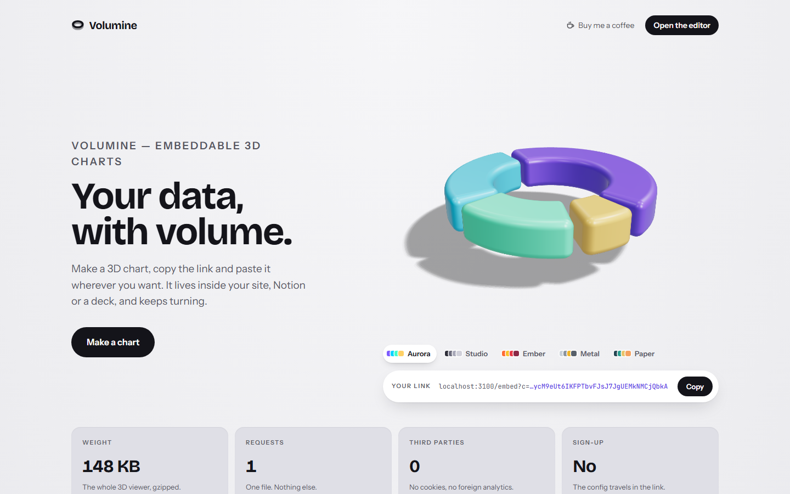
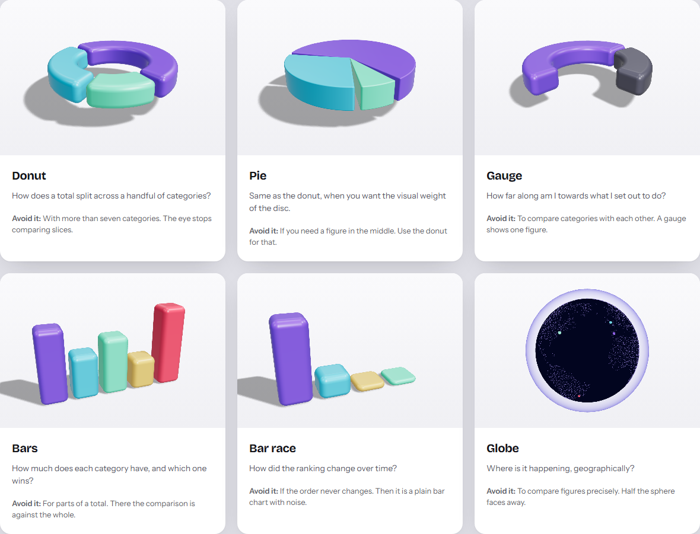
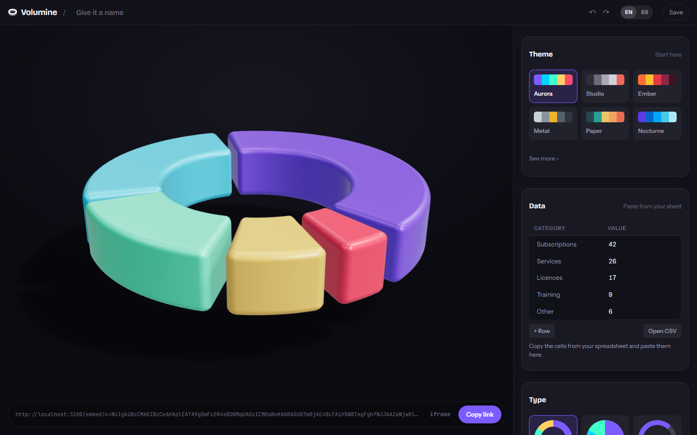
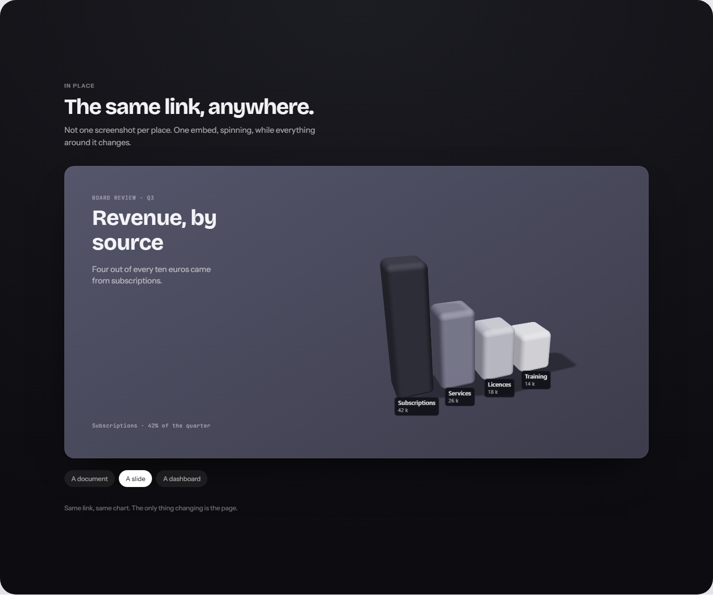
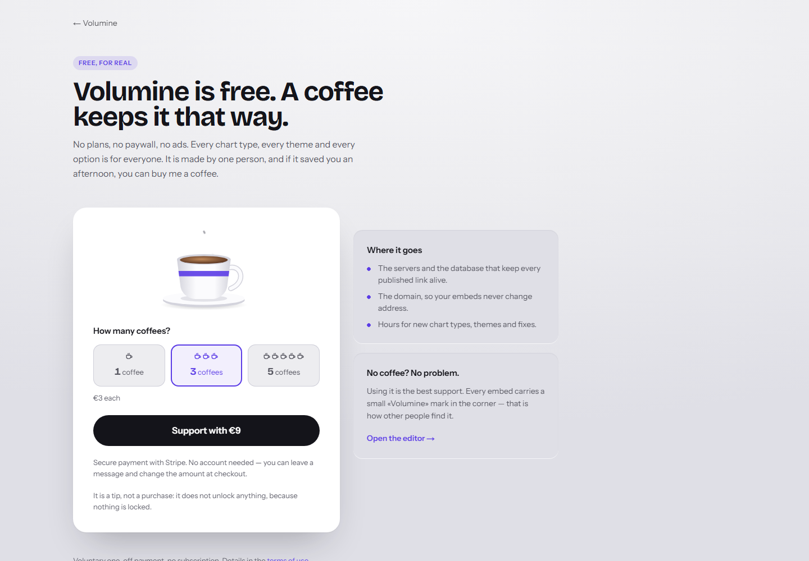
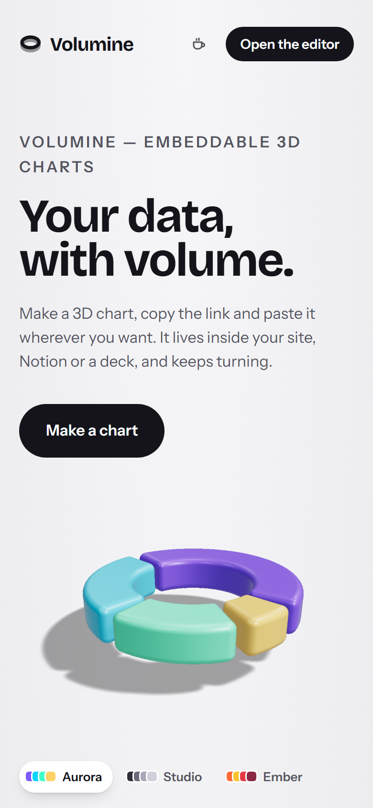

<div align="center">


# Volumine

**Embeddable 3D charts. The product is the link.**

Make a chart, copy the URL, paste it anywhere — Notion, Confluence, your own site.<br />
What shows up isn't a screenshot: it's the chart itself, alive, turning, under 150 KB.

[**volumine.app**](https://volumine.app) · [Open the editor](https://volumine.app/crear) · [How it works](https://volumine.app/como-funciona) · [☕ Buy me a coffee](https://volumine.app/cafe)




</div>

---

## Why

Most chart tools that offer an embed give you one that is ugly, heavy, or behind
a paywall. 3D charts are usually worse: a 1 MB library, a loading spinner, and a
cookie banner for the host page.

Volumine goes the other way. Every chart is a real 3D object — bevelled edges,
soft studio light, a contact shadow — and the embed that draws it is a single
hand-written HTML page with **one** script request, **no** cookies and **no**
third parties. It is built to disappear into whatever page it lives in.

<p align="center">
  
</p>

## How it works

1. **Paste your data.** Copy cells straight from Excel or Google Sheets. Rows are
   categories, columns are series — and a table with years across the top
   becomes a bar race on its own. Spanish number formats (`1.234,56`) are
   understood too.
2. **Pick a look.** 15 themes, materials (physical, matte, glass, metal, toon),
   labels, legend, motion. Every control maps to one field of a versioned
   config, so the editor can never reach a broken state.
3. **Copy the link.** Paste it where oEmbed is supported and it unfurls into the
   live chart; anywhere else, use the `<iframe>` snippet. No account needed for
   any of it.

## Six chart types

<p align="center">
  
</p>

| Type         | Answers                                           | Avoid it when…                        |
| ------------ | ------------------------------------------------- | ------------------------------------- |
| **Donut**    | How does a total split across a few categories?   | You have more than seven categories   |
| **Pie**      | Same, when you want the visual weight of the disc | You need a figure in the middle       |
| **Gauge**    | How far along am I towards a target?              | You want to compare categories        |
| **Bars**     | How much does each category have, and who wins?   | You are showing parts of a whole      |
| **Bar race** | How did the ranking change over time?             | The order never changes               |
| **Globe**    | Where is it happening, geographically?            | You need to compare figures precisely |

Every card in the gallery says _when not to use it_. A 3D chart only earns its
place when the shape still tells the truth.

## The editor

<p align="center">
  
</p>

- **Live preview** with the exact renderer the embed uses — same config, same pixels.
- **Undo / redo** (`Ctrl+Z` / `Ctrl+Shift+Z`) across every change.
- **Data table** with paste, CSV import, per-segment colours and a header guess you can override.
- **Globe helpers**: type “Madrid” and its coordinates fill in (~95 places, accent-insensitive).
- **Save & publish** with an account: you get a short `/embed/{slug}` link that keeps working while you edit, plus a poster image for link previews.
- **English and Spanish** UI, chosen from the browser and remembered with one cookie.

## One link, anywhere

<p align="center">
  
</p>

Works in **Notion, Confluence, Webflow, WordPress, Framer, Canva** and any page
that accepts an `<iframe>`. There is an oEmbed endpoint (`/api/oembed`) and the
embed is tested inside a `sandbox`ed iframe, which is what Confluence Cloud uses.

```html
<iframe
  src="https://volumine.app/embed/AbCd1234"
  width="100%"
  height="420"
  style="border:0"
  loading="lazy"
  title="Revenue by source"
></iframe>
```

The embed talks to the host page with `postMessage` (`ready` and `resize`
events carry the height, for auto-sizing), and a few query parameters override
the saved look without touching it: `?theme=`, `?bg=`, `?transparent=1`,
`?autorotate=`.

### The whole chart lives in the URL

Charts don't need an account or a database. The entire config is JSON,
compressed with `lz-string`, in the `c` parameter:

```jsonc
// https://volumine.app/embed?c=<lz-string of this>
{
  "v": 1,
  "type": "donut",
  "title": "Revenue by source",
  "data": {
    "labels": ["Subscriptions", "Services", "Licences"],
    "series": [{ "name": "2026", "values": [42, 26, 17] }],
  },
  "theme": "aurora",
}
```

Everything except `v`, `type` and `data` is optional and has sensible defaults.
The contract is versioned and **a published link must work forever**: changing
the schema means a new version plus a migration, never a breaking edit. The
full reference (in Spanish) is in [`docs/chart-config-schema.md`](docs/chart-config-schema.md).

## The embed budget

What loads on the page of whoever views the chart. It is measured on every
build by `npm run perf:embed`, and **the build fails if it goes over**.

|                               | Now      | Limit  |
| ----------------------------- | -------- | ------ |
| JavaScript (gzip)             | 149.0 KB | 180 KB |
| CSS (inlined in the HTML)     | 5.5 KB   | 8 KB   |
| Font (only if the chart asks) | 26.8 KB  | 32 KB  |
| Requests to third parties     | 0        | 0      |

One request from the HTML. Zero cookies. That means embedding a chart adds
nothing to the host site's privacy policy — and it keeps working inside the
strictest sandboxes.

To get there, the embed doesn't use React at all: `/embed` is a route handler
that returns hand-written HTML, and the renderer is plain three.js
([ADR 0006](docs/adr/0006-el-embed-usa-three-en-plano-sin-react.md)). The 3D
geometry — bevelled sectors, rounded bars, the dot-cloud globe — is written from
scratch: no chart library, no echarts-gl, no plotly
([ADR 0004](docs/adr/0004-geometria-propia-sin-libreria-de-graficas.md)).

## Free, with a coffee jar

<table>
  <tr>
    <td width="62%"></td>
    <td width="38%"></td>
  </tr>
</table>

Volumine is free: every chart type, every theme, every option, for everyone.
There are no plans and no paywall. If it saved you an afternoon, you can
[buy me a coffee](https://volumine.app/cafe) — it's a tip through Stripe, no
account needed, and it doesn't unlock anything because nothing is locked
([ADR 0008](docs/adr/0008-gratis-con-cafes-en-vez-de-plan-de-pago.md)).

## Tech stack

- **Next.js 16** (App Router) · **React 19** · **TypeScript** in strict mode
- **three.js**, plain, for the renderer shared by the editor and the embed
- **Supabase** — Postgres, Auth and Storage. Permissions are enforced by
  Postgres row-level security, not by the app server
  ([ADR 0007](docs/adr/0007-los-permisos-los-decide-postgres.md))
- **Zod** for the config contract · **lz-string** for config-in-URL
- **Stripe** Checkout for the coffee jar
- **Tailwind v4** + hand-written CSS with design tokens
- **Vitest** (257 unit tests: geometry, contract, data parsing) +
  **Playwright** (e2e, i18n sweeps, font budget, screenshots)
- **Vercel**

## Project layout

```
src/
  app/
    (site)/      the app: landing, editor, my charts, coffee, legal, integrations
    (embed)/     /embed and /api/oembed — route handlers, no React
  embed/         the embed's HTML, written by hand as a string
  renderer/      scene, materials, lights and the label layer
    geometry/    the custom geometry: bevelled sectors, bars, globe
  lib/           schema, config-in-URL, themes, i18n, charts, legal
supabase/
  migrations/    in order, with RLS from the very first one
scripts/         embed build, font subsetting, OG image, icons, README shots
docs/            PRD, schema, budget, design, ADRs and project state
```

`/embed` deliberately shares **no layout** with the rest of the app — there is
no root `app/layout.tsx` — so providers, fonts and analytics can never leak into
it by inheritance.

## Getting started

```bash
npm install
cp .env.example .env.local     # then fill it in
npm run build && npm start     # production build on :3000
```

> The editor and config-in-URL embeds work **without any environment
> variables**: a fresh clone runs. Supabase adds accounts and saved charts;
> Stripe adds the coffee button.

| Variable                        | What for                                             |
| ------------------------------- | ---------------------------------------------------- |
| `NEXT_PUBLIC_SUPABASE_URL`      | Your Supabase project                                |
| `NEXT_PUBLIC_SUPABASE_ANON_KEY` | Public key — the real protection is RLS              |
| `STRIPE_SECRET_KEY`             | Optional. Enables the coffee button on `/cafe`       |
| `STRIPE_WEBHOOK_SECRET`         | Optional. Only if a Stripe webhook points at the app |

## Scripts

```bash
npm run dev            # dev server on :3000
npm run build          # embed bundle + fonts + Next build
npm run lint           # eslint + tsc --noEmit
npm run test           # vitest
npm run test:e2e       # playwright (against `next start -p 3100`)
npm run perf:embed     # measure /embed against the budget
npm run readme:shots   # regenerate the screenshots in this README
```

Brand material, run by hand rather than on every deploy:

```bash
npm run og             # link-preview image
npm run icons          # favicon.ico and apple-icon from icon.svg
npm run x:gif          # the rotating chart GIF
npm run x:video        # the “moment of the link” video
```

## Documentation

The docs are written in Spanish.

| Document                                                                                                 | What's inside                                               |
| -------------------------------------------------------------------------------------------------------- | ----------------------------------------------------------- |
| [`docs/STATE.md`](docs/STATE.md)                                                                         | **Where the project is right now.** Read this first         |
| [`docs/PRD.md`](docs/PRD.md)                                                                             | What the product is, who it's for, and what it is **not**   |
| [`docs/chart-config-schema.md`](docs/chart-config-schema.md)                                             | The `ChartConfig` contract — the most important doc in here |
| [`docs/PERFORMANCE-BUDGET.md`](docs/PERFORMANCE-BUDGET.md)                                               | The embed budget, and the reason behind every number        |
| [`docs/DESIGN.md`](docs/DESIGN.md)                                                                       | Art direction and the accessibility bar                     |
| [`docs/ROADMAP.md`](docs/ROADMAP.md)                                                                     | What's next, in order                                       |
| [`docs/PAGOS.md`](docs/PAGOS.md) · [`docs/LEGAL.md`](docs/LEGAL.md) · [`docs/CORREO.md`](docs/CORREO.md) | Operations: payments, legal, email                          |
| [`docs/adr/`](docs/adr/)                                                                                 | Eight closed decisions, each with its why                   |

The code carries long comments where they were needed. They don't explain what
a line does — they explain **why it isn't the other thing**. Most of them come
from a bug that reached production.

## License

No open-source license. All rights reserved.
